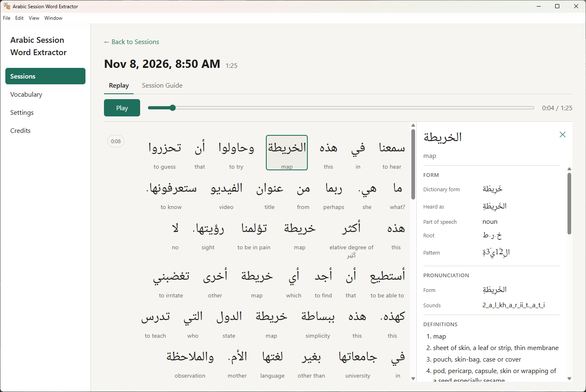
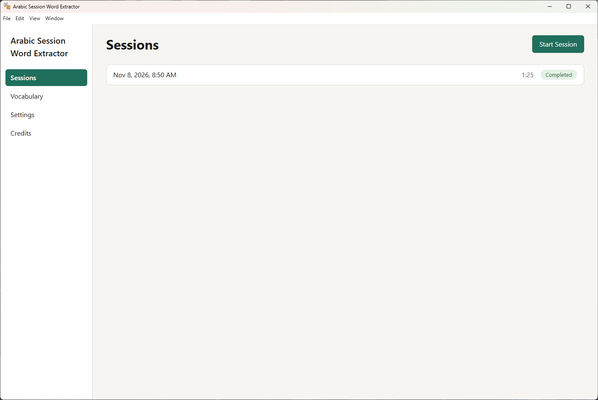
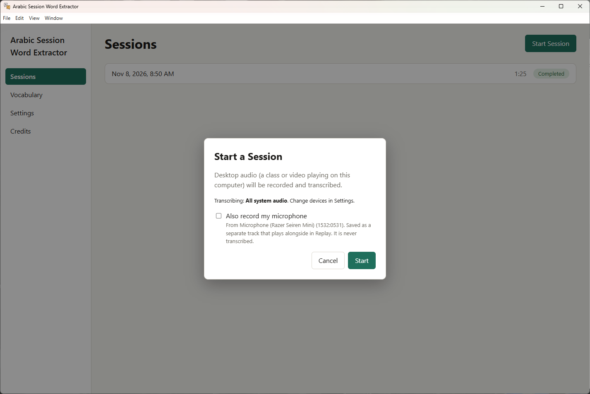
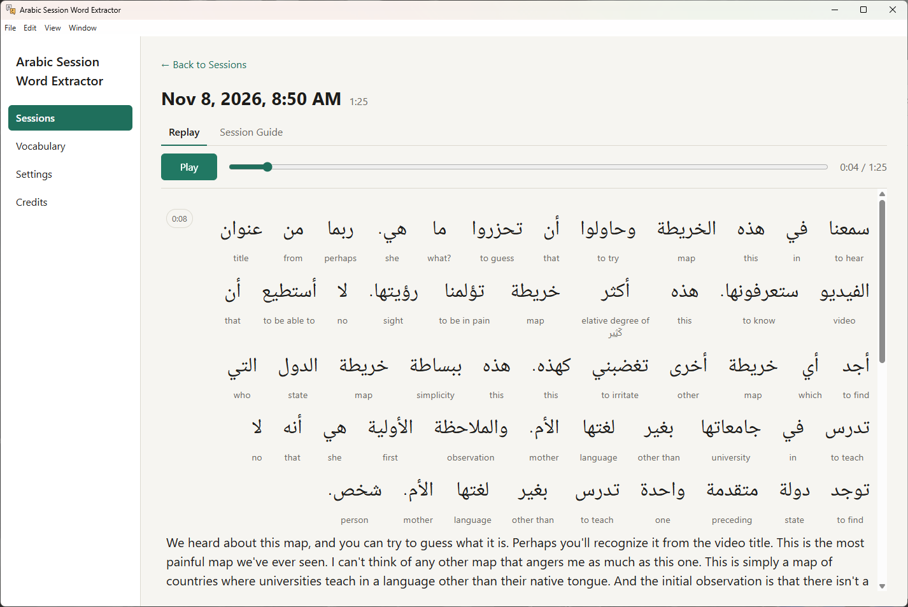
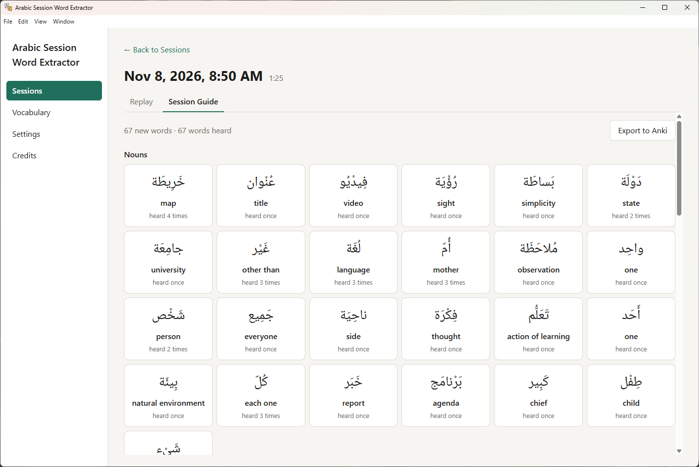
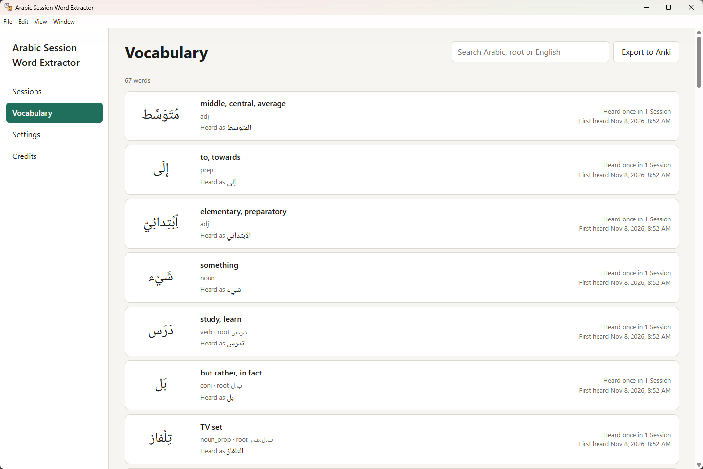
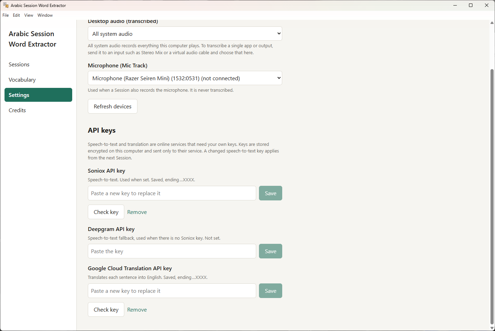

# Arabic Session Word Extractor

A Windows desktop app for learners of **Modern Standard Arabic**. It listens to the Arabic playing on your computer (an online class, a lecture, a YouTube video), shows a live transcript in Arabic script with an English gloss under every word and a translation under every sentence, and adds every word it hears to your own Vocabulary.

When the recording stops, the app keeps it: you can replay the audio and follow along word by word, click any word for its dictionary details, review a study guide of the new words you met, and export your words to Anki.



## Features

- **Live transcript.** Desktop audio is sent to a speech-to-text service and shown right to left as it is spoken. Unfinished text is muted, then firms up when the sentence is final.
- **Word-by-word glosses.** Each word gets a short English gloss from a bundled dictionary (Wiktionary). Each sentence gets a full English translation.
- **Click any word.** A side panel shows the dictionary form, the root, the pattern, the part of speech, a pronunciation, full definitions, example sentences, your own sentences that used the word, and the Sessions you heard it in.
- **Vocabulary.** Every word you hear is filed under its dictionary form (Lemma), with the spellings you heard, how often you heard it and when you first heard it. You can search it in Arabic or English, by root, with or without vowel marks.
- **Study guides.** Each word gets a Word Card. Each recording gets a Session Guide that lists the words new to you, grouped by part of speech.
- **Replay.** Play a past Session while the current word is highlighted. Click a sentence to jump to it.
- **Optional microphone track.** Record your own voice too, as a separate track that plays back in sync. Ask for it to be transcribed and Live View shows what you said, marked **You** and translated, but never added to your vocabulary.
- **Anki export.** Export your whole Vocabulary, or one Session's new words, as an `.apkg` deck. Importing it again updates the cards rather than duplicating them.
- **Local and private.** Recordings, transcripts and your Vocabulary stay on your computer. Only the audio (to speech-to-text) and each sentence's text (to translation) are sent out, and only to the services whose keys you enter.

## Screenshots

| | |
|---|---|
|  **Sessions:** your past recordings, and where you start a new one. |  **Start a Session:** choose whether to also record your microphone. |
|  **Replay:** the transcript follows the audio. |  **Session Guide:** the words that were new to you in this Session. |
|  **Vocabulary:** every word you have heard, searchable. |  **Settings:** audio devices and API keys. |

## Install

1. Download `Arabic-Session-Word-Extractor-Setup-<version>.exe` from the [latest release](https://github.com/justin34/ArabicSessionWordExtractor/releases/latest).
2. Run it. The Installer is not code-signed yet, so Windows SmartScreen may warn you once. Click **More info**, then **Run anyway**.
3. Follow the wizard (licence, install folder) and launch the app at the end.

The app runs on Windows 10 and 11 (64-bit). It installs for your user only and needs no administrator rights. Everything the app needs offline (the Arabic analyzer, the dictionary and the Arabic font) is bundled. The app checks GitHub for updates when it starts and offers **Restart to update** when one has downloaded.

## Get your API keys

Speech-to-text and translation are online services, and the app uses **your own** keys for them. No keys ship with the app. You need:

| Key | What it does | Needed? |
|---|---|---|
| **Soniox** | Speech-to-text (turns the Arabic audio into text) | Yes, or Deepgram instead |
| **Deepgram** | Speech-to-text fallback, used only when there is no Soniox key | Only if you have no Soniox key |
| **Google Cloud Translation** | Translates each sentence into English | Recommended |

Without a speech-to-text key, a Session still records audio but produces no transcript. Without a translation key, sentences stay in Arabic only. Word glosses and word details still work, because they come from the bundled dictionary.

**Soniox is the recommended speech-to-text service.** In this project's tests on real class audio, it made fewer errors on MSA than Deepgram (about 5.5% of words against 9.2%). It also writes proper hamza, ة and punctuation, and lists at about a quarter of Deepgram's price per hour. Both services charge per minute of audio, so check each one's current pricing and free credits.

### Soniox (speech-to-text)

1. Go to [console.soniox.com](https://console.soniox.com) and sign up.
2. Open **API keys** and create a key.
3. Copy the key.

### Deepgram (optional fallback)

1. Go to [console.deepgram.com](https://console.deepgram.com) and sign up.
2. Open your project, then **API Keys**, and create a key.
3. Copy the key. Deepgram shows it only once.

### Google Cloud Translation

1. Go to the [Google Cloud console](https://console.cloud.google.com/) and create a project, or pick an existing one. A billing account must be linked to the project for the API to work. The Basic (v2) API has a free monthly allowance, which covers a lot of class time.
2. Enable the API: open [Cloud Translation API](https://console.cloud.google.com/apis/library/translate.googleapis.com) and click **Enable**.
3. Go to **APIs & Services → [Credentials](https://console.cloud.google.com/apis/credentials)**, click **Create credentials → API key**, and copy it.
4. Recommended: click **Edit API key** and, under **API restrictions**, choose **Restrict key** and select only **Cloud Translation API**.

### Enter the keys in the app

1. Open **Settings** in the sidebar and scroll to **API keys**.
2. Paste each key into its field and click **Save**.

   The app checks the key straight away and tells you whether it works. If the key is refused, the message says where to get a working one. If the service cannot be reached, the key is kept and you can try **Check key** again later.

Keys are stored encrypted on your computer (with Windows DPAPI) and sent only to their own service. The app never shows a saved key again, only its last four characters. To change a key, paste a new one over it. To delete it, click **Remove**. A changed speech-to-text key takes effect from the next Session.

## How to use it

### 1. Choose your audio (once)

In **Settings → Audio**:

- **Desktop audio (transcribed):** **All system audio** records everything your computer plays. This is what you want for Zoom, Teams or a browser video. Windows cannot record one app on its own, so to transcribe only one app, route it to an input such as Stereo Mix or a virtual audio cable and choose that input here.
- **Microphone (Mic Track):** the microphone used when you choose to record yourself.

Tip: mute other sounds (music, notifications) while recording. Everything on the desktop audio is transcribed.

### 2. Record a Session

1. On **Sessions**, click **Start Session**.
2. Tick **Also record my microphone** if you want your own voice saved as a separate track. Tick **Also transcribe my speech** under it to see what you say in Live View too (use headphones so the teacher isn't transcribed as you; speech-to-text usage roughly doubles while you speak).
3. Click **Start**, then play your class or video.

The **Live View** shows the Arabic as it is spoken. Once a sentence is final, a gloss appears under each word and the English translation fills in beneath the sentence. Click any word to open its panel. Recording carries on.

4. Click **Stop** when you are done. Everything is saved automatically.

If speech-to-text drops out (network loss, a refused key), the audio keeps recording and Live View says why the transcript stopped. Nothing but **Stop** ends a recording.

### 3. Review it

Open a completed Session from the **Sessions** list.

- **Replay:** press **Play** and the current word is highlighted as the audio plays. Click a sentence, or its time, to jump there. Click a word to see its details without losing your place.
- **Session Guide:** the words you heard for the first time in this Session, grouped as Nouns, Verbs, Adjectives and so on, with how often each was heard. Click a word to open its Word Card.

### 4. Study your Vocabulary

**Vocabulary** lists every word you have heard in every Session. Search by Arabic (vowel marks optional), root or English meaning. Click a word to open its Word Card, with definitions, examples and where you heard it.

### 5. Export to Anki

Click **Export to Anki** on the Vocabulary screen (all words) or on a Session Guide (that Session's new words). Choose where to save the `.apkg`, then open it in Anki. Each card shows the Arabic word on the front, with the gloss, definitions, root, pronunciation and an example on the back. Exporting again later updates your existing cards instead of duplicating them.

### Where your data lives

Recordings, the database and settings are stored in `%APPDATA%\Arabic Session Word Extractor`. Uninstalling keeps them, unless you tick **Also delete my recordings and vocabulary** in the uninstaller.

## Limitations

- Windows only.
- Modern Standard Arabic (Fusha) only. Dialects are not supported.
- Arabic to English only.
- Speakers are told apart only by track: the desktop audio is the teacher, the microphone is you. Your own speech is shown live only; Replay does not show it yet.

## Development

You need Node.js and npm. The Arabic analyzer helper and the dictionary are built by scripts and are not checked in:

```bash
npm install
```

```bash
npm run build:helper
```

```bash
npm run build:dictionary
```

```bash
npm run dev
```

For development you can put keys in a git-ignored `.env` file instead of entering them in Settings (see [.env.example](.env.example)). Keys saved in Settings take priority.

| Command | What it does |
|---|---|
| `npm run dev` | Run the app in development |
| `npm test` | Run the tests (Vitest) |
| `npm run typecheck` | Type-check |
| `npm run build:helper` | Build the bundled Python CAMeL Tools helper into `vendor/camel-helper/` |
| `npm run build:dictionary` | Download Wiktionary and Tatoeba data and build `vendor/dictionary/dictionary.db` (downloads about 3 GB the first time) |
| `npm run dist` | Build the Windows Installer into `%LOCALAPPDATA%\ArabicSessionWordExtractor-build` |
| `npm run release` | Self-check the packaged build and upload it as a draft GitHub Release |

Project vocabulary (Session, Utterance, Token, Lemma and so on) is defined in [GLOSSARY.md](GLOSSARY.md), and design decisions are in [docs/adr/](docs/adr/).

## Credits and licence

The app is licensed under the [GPL-2.0-or-later](LICENSE).

It builds on [CAMeL Tools](https://github.com/CAMeL-Lab/camel_tools) and its MSA morphology data for Arabic analysis, [Wiktionary](https://en.wiktionary.org) (CC BY-SA 4.0, extracted with [wiktextract/kaikki.org](https://kaikki.org)) for definitions, [Tatoeba](https://tatoeba.org) (CC BY 2.0 FR) for example sentences, and the Noto Naskh Arabic font (OFL 1.1). The app icon is "Arabic" by Magnific on [Flaticon](https://www.flaticon.com/free-icons/arabic). Full licence texts are in [licenses/](licenses/), and all credits are on the app's **Credits** screen.
